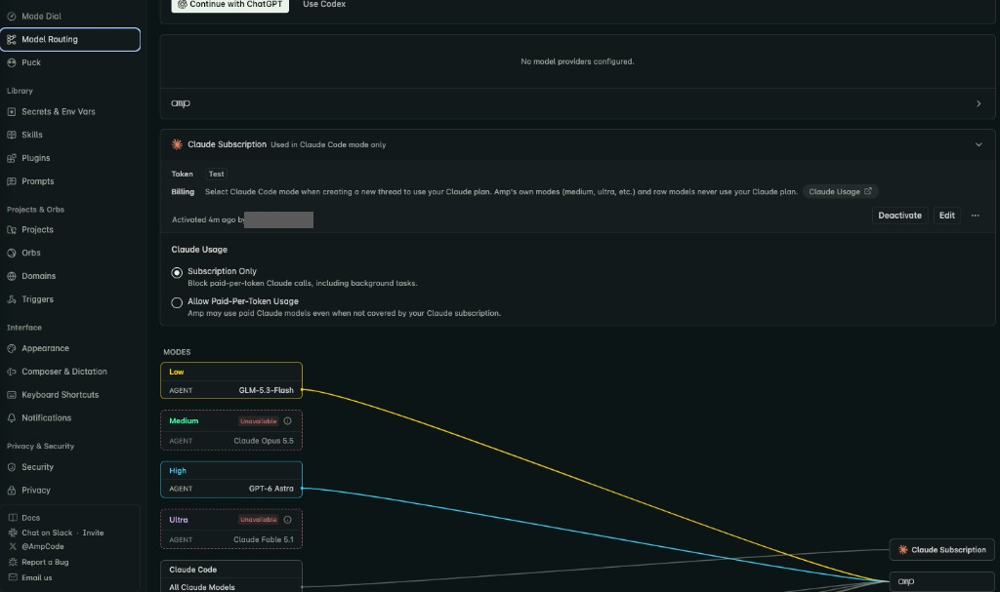
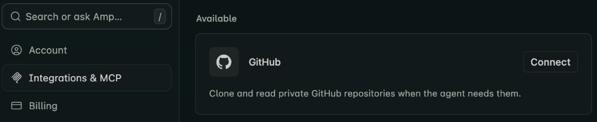
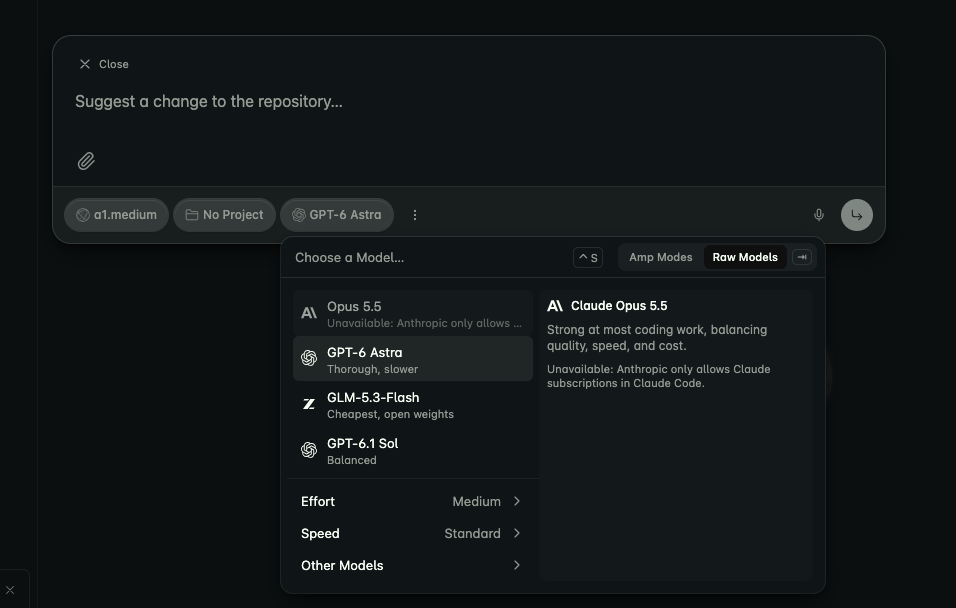
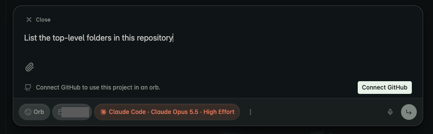

# Move to Claude Code

This guide takes you from a clean Mac to Claude Code with the Soofi team kit
installed, checked and tested, and then moves the agents you run in Cursor today. You do not
need to have used our agents before. It is for new hires as much as for people moving from
Cursor: if you never used Cursor, step 7 is a quick **none**. Follow the steps in order.

Every step tells you:

- **Where** to run it: a **regular terminal** (the Terminal app), **inside Claude Code**
  (after you typed `claude` and see its `❯` prompt), or the **browser**.
- **Run**: what to type or click.
- **You should see**: what the screen looks like when the step worked.
- **If you don't**: what to do instead.

> **Want an agent to walk you through it?** In Cursor, ask
> `/move-to-claude-code walk me through the guide`; in Claude Code, once step 4 is done, it
> is `/soofi-xyz-team-kit:move-to-claude-code`. It goes one step at a time, shows the
> screenshot for each step and notes where you got stuck for the [pass-it-on](#pass-it-on)
> pull request. With neither installed yet, follow this page on its own.

**Stuck on something this guide does not cover?** Write down exactly what you saw, ask
Mykyta Ovsiienko, and add it to the guide afterwards (see [Pass it on](#pass-it-on)).

## Contents

0. [Before you start](#0-before-you-start)
1. [Pick the Claude plan and organization](#1-pick-the-claude-plan-and-organization)
2. [Install Claude Code](#2-install-claude-code)
3. [Start Claude Code and sign in](#3-start-claude-code-and-sign-in)
4. [Install the Soofi team kit](#4-install-the-soofi-team-kit)
5. [Check and test everything](#5-check-and-test-everything)
6. [Set up Amp for cloud runs (token)](#6-set-up-amp-for-cloud-runs-token)
7. [Move the agents you run today](#7-move-the-agents-you-run-today)
8. [Pass it on](#pass-it-on)
9. [Update or remove](#update-or-remove)

---

## 0. Before you start

You need a Mac (macOS 13 or later), your Prism Google account (`you@prismteam.ai`) and your Ramp
card.

**Open a regular terminal.** Press `⌘ Space`, type `Terminal`, press `Return`. Every
"regular terminal" step below runs here.

### 0.1 Developer tools (git)

**Where:** regular terminal

**Run:**

```bash
xcode-select -p || xcode-select --install
```

**You should see:** a path such as `/Library/Developer/CommandLineTools`. If the tools were
missing, a macOS window asks to install them. Click **Install**, wait until it finishes,
then run the command again to see the path.

**If you don't:** if the window says the software is not available, install Xcode from the
App Store, open it once, and run the command again.

### 0.2 Homebrew and Node

**Where:** regular terminal

Skip this whole step if `node -v` already prints `v22.18.0` or higher (for example from
`nvm`).

**Run** (skip the first line if `brew --version` already prints a version):

```bash
/bin/bash -c "$(curl -fsSL https://raw.githubusercontent.com/Homebrew/install/HEAD/install.sh)"
brew install node
```

**Reused Mac, or you are not an admin:** Homebrew is one install per Mac (`/opt/homebrew`),
not one per user. If `brew` is missing, or `brew install` fails with `Permission denied`
because another user installed it, skip Homebrew: no `sudo brew`, no permission changes on
`/opt/homebrew`, no second Homebrew in your home folder. Install
[nvm](https://github.com/nvm-sh/nvm#installing-and-updating) instead (no admin rights
needed), open a new terminal window, then run:

```bash
nvm install 22 && nvm alias default 22
```

The kit's elephant MCP server finds an nvm Node under `~/.nvm` by itself, and Claude Code
installs into `~/.local/bin` (step 2), so nothing in this guide needs Homebrew.

**You should see:** `node -v` prints `v22.18.0` or higher.

**If you don't:**

- `brew: command not found` after installing Homebrew: run the two `echo … >> ~/.zprofile`
  and `eval …` lines that the Homebrew installer printed under **Next steps**, then open a
  new terminal window.
- `node -v` is below `v22.18.0`: run `brew upgrade node`. If you use `nvm`, run
  `nvm install 22 && nvm alias default 22`.

---

## 1. Pick the Claude plan and organization

**Where:** browser

**Run:**

1. Go to [claude.ai](https://claude.ai/).
2. Sign in with **Continue with Google** and pick your **Prism Google account**
   (`you@prismteam.ai`). Do not use a personal Gmail account.
3. When asked *How are you planning to use Claude?*, choose **For personal use**.
   Do not choose *With my team*.
4. When the plans are listed, choose **Max or Ultra**.
5. Choose **Ultra**.
6. Pay with your **Ramp card**.
7. Finish the extra onboarding screens claude.ai shows after paying, such as
   **Quick identity check** (*We need to confirm your identity before you can continue.
   This should only take 2 minutes.*). They are not captured yet; if you can, screenshot
   them for your pass-it-on pull request.


**You should see:** the claude.ai chat home page with your plan name in the account menu
(bottom left). Your organization is the personal one Claude creates for your Prism
account. It is named `you@prismteam.ai's Organization`, and it is the one you sign in to
in step 3.

**If you don't:**

- The card is declined: check the Ramp card limit with your manager, then retry.
- Ramp asks you to create a new business account (company details and so on): stop. You
  need an invite to Prism's Ramp account, not a new one. Ask your manager for it, then come
  back to this step.
- You see a team or enterprise organization instead of `you@prismteam.ai's Organization`:
  open the account menu, choose your personal organization, and continue.
- Do not buy a second plan if you already have Ultra or Max on this account. Both work.

---

## 2. Install Claude Code

**Where:** regular terminal

If `claude --version` already prints a version in a new terminal window, Claude Code is
installed and on your PATH: skip the installer (run `claude update` if it is older than the
version in the screenshot below), and do not add the PATH line below again (it would only
duplicate the line in `~/.zshrc`).

**Run:**

```bash
curl -fsSL https://claude.ai/install.sh | bash
```

The command shows nothing for up to a minute while it downloads. Wait.

**You should see:** `✔ Claude Code successfully installed!` with a version and the location
`~/.local/bin/claude`, and on the last line `✅ Installation complete!`.


Then open a **new** terminal window (`⌘ N`) and run:

```bash
claude --version
```


**If you don't:**

- The installer shows **Setup notes** saying `~/.local/bin is not in your PATH`, or
  `claude --version` says `command not found: claude`. Run the line it printed, then open a
  new terminal window:

  ```bash
  echo 'export PATH="$HOME/.local/bin:$PATH"' >> ~/.zshrc && source ~/.zshrc
  ```

  

- `curl: (6) Could not resolve host` or a `403`: you are offline or behind a VPN that
  blocks `claude.ai`. Disconnect the VPN and retry.

---

## 3. Start Claude Code and sign in

### 3.1 First launch

**Where:** regular terminal, inside a project folder (any folder of yours works; for
example `mkdir -p ~/Projects && cd ~/Projects`)

**Run:**

```bash
claude
```

Claude Code opens full-screen in the terminal and asks a few one-time questions:

1. **Text style:** pick **Dark mode** (or whatever looks best) with the arrow keys and
   press `Return`.

   

2. **Security notes:** press `Return`.

   

3. **Trust this folder:** press `↓` to select **Yes, I trust this folder**, then `Return`.
   The selection starts on **No, exit** in a new folder. Pressing `Return` straight away
   quits Claude Code.

   

Claude Code may also ask **Use Claude Code's terminal setup?** Choose **Yes**.

### 3.2 Sign in

**Where:** inside Claude Code (it asks on first launch; otherwise type `/login` and press
`Return`)

**Run:** choose **1. Claude account with subscription**.


**Where:** browser. A window opens on its own; if it doesn't, press `c` in Claude Code to
copy the link and paste it into your browser.

**Run:** check that the page says *Logged in as* your `@prismteam.ai` address, then click
**Authorize**.


If the browser shows a code instead of returning to the terminal, copy it and paste it
into Claude Code at `Paste code here if prompted`.

**You should see:** `Login successful` in Claude Code, press `Return`.

### 3.3 Updated terms (if shown)

**Where:** inside Claude Code

If Claude Code shows **Updates to Consumer Terms and Policies**, choose
**2. Accept terms · Help improve our AI models: OFF** for company work, then press `Return`.
Until you answer this screen, every agent and test prompt fails with
`[ACTION REQUIRED] An update to our Consumer Terms…`.


**You should see:** the Claude Code home screen with your model and plan in the header
(for example `Opus 5.5 · Claude Ultra`) and an empty `❯` prompt at the bottom.


Type `/exit` and press `Return` to go back to the regular terminal.

**If you don't:**

- The header says `API Usage Billing` or the check in step 5 says you are not on a
  subscription: inside Claude Code run `/logout`, then `/login`, and pick option **1**.
- The browser shows a different Google account: click **Switch account** at the bottom of
  the Authorize page and pick your Prism account.
- To confirm from a regular terminal: `claude auth status --text` prints
  `Login method: Claude … account`, `Organization: you@prismteam.ai's Organization`, and
  your email.

---

## 4. Install the Soofi team kit

**Where:** regular terminal (not inside Claude Code)

### 4.1 Install

**Run:**

```bash
claude plugin marketplace add soofi-xyz/soofi-xyz-team-kit
claude plugin install soofi-xyz-team-kit@soofi-xyz
```

**You should see:** `✔ Successfully added marketplace: soofi-xyz`, then
`✔ Successfully installed plugin: soofi-xyz-team-kit@soofi-xyz (scope: user)`.


### 4.2 Confirm

**Run:**

```bash
claude plugin list
```

**You should see:** `soofi-xyz-team-kit@soofi-xyz` with `Status: ✔ enabled`. The line
`Note: Default agents/ folder is ignored because the manifest sets "agents"` is expected;
ignore it.


**If you don't:**

- `Failed to clone`: check that you are online and that `git --version` works (step 0.1),
  then retry.
- `Marketplace 'soofi-xyz' already exists`: it was added before. Run
  `claude plugin marketplace update soofi-xyz` and continue with the install line.
- `Plugin not found`: copy the install line exactly, including `@soofi-xyz`.
- If Claude Code was open while you installed, type `/reload-plugins` inside it, or quit
  and start it again.

### 4.3 Download the elephant MCP server once

**Where:** regular terminal, with Claude Code closed

The kit's elephant MCP server is fetched by `npx` the first time it starts, which can take
longer than the 30 seconds Claude Code waits for a server. Fetch it once now:

```bash
npx -y --package=github:elephant-xyz/elephant-mcp#main mcp
```

The fetch takes a few minutes and shows little meanwhile. Wait.

**You should see:** a line containing `Starting MCP server with stdio transport`, then the
server syncing county data. Lines about `No embedding provider available`, `Failed to index
file` or AWS credentials are expected. An `Atlas startup synchronization failed` line with
`HTTP 429` means the public gateways rate-limited the sync; the server still works, see the
last bullet of [step 5.3](#53-one-test-prompt-for-an-agent-and-the-mcp-server). Press
`Ctrl-C`.

**If you don't:** a stack trace means the server crashes on start; see **Elephant fails
while Node is fine** in [step 5.1](#51-one-check-command).

---

## 5. Check and test everything

### 5.1 One check command

**Where:** regular terminal

**Run:**

```bash
curl -fsSL https://raw.githubusercontent.com/soofi-xyz/soofi-xyz-team-kit/main/skills/team-kit-check/scripts/team-kit-check.sh | bash -s -- --test
```

It reports what is installed, which agents are available, which MCP servers are connected
or failing, and sends one test prompt to an agent and to each MCP server. Each failure comes with
its fix and where to run it. Drop `-s -- --test` for a quicker check without test prompts,
or use `--agents` to list every agent name. Inside Claude Code, the same check runs with
`/soofi-xyz-team-kit:team-kit-check`.

**You should see:** only `✔` lines and, at the end,
`✔ Everything required is installed and connected.`


A `!` line is a warning, such as a newer kit version being available; apply its fix when
convenient. Every `✘` line has a fix under it.

**If you don't:** apply the fix printed under each `✘`, then run the check again. The most
common ones:

| You see | Fix | Where |
| --- | --- | --- |
| `Claude Code is installed at ~/.local/bin/claude but that folder is not on your PATH` | `echo 'export PATH="$HOME/.local/bin:$PATH"' >> ~/.zshrc && source ~/.zshrc` | regular terminal |
| `Not signed in` | `claude`, then `/login`, option **1** | inside Claude Code |
| `blocked by the updated Consumer Terms` | `claude`, answer the terms screen (option **2**), `/exit` | inside Claude Code |
| `marketplace '…' is not added` / `not installed` | the two lines from step 4 | regular terminal |
| `plugin:soofi-xyz-team-kit:elephant: ✘ Failed to connect` and the Prerequisites line says Node is missing or too old | Node 22.18+ as in [step 0.2](#02-homebrew-and-node), then run the check again (`/exit` any open Claude Code first) | regular terminal |
| `plugin:soofi-xyz-team-kit:elephant: ✘ Failed to connect` while Node is already 22.18+ (`connection timed out after 30000ms` or `Connection closed`) | see **Elephant fails while Node is fine** below | regular terminal |
| `! Needs authentication` | `/mcp`, select the server, **Authenticate**. `claude mcp login` does not exist (Claude Code 2.1.87: `error: unknown command 'login'`). | inside Claude Code |
| `claude-design: ! Needs authentication`, and **Authenticate** fails with `HTTP 403: Invalid OAuth error response` and a Cloudflare `Just a moment...` page | see **claude-design will not authenticate** below | regular terminal |
| `Signed in as …, not a @prismteam.ai account` | `/logout`, then `/login` with your Prism account; check with `claude auth status --text` | inside Claude Code |

**claude-design will not authenticate.** `claude-design` is Anthropic's own design MCP
server (`https://api.anthropic.com/v1/design/mcp`). Claude Code may add it for you. It is not
part of the kit and nothing in this guide needs it. On the second walkthrough (2026-11-04)
Cloudflare blocked its sign-in with `HTTP 403`, also with every VPN off. Remove it:

```bash
claude mcp remove "claude-design" -s user
```

To add it back later:
`claude mcp add --transport http -s user claude-design https://api.anthropic.com/v1/design/mcp`.
The failed sign-in also switched Claude Code to another (non-Prism) account. Run
`claude auth status --text`. If the email is not your `@prismteam.ai` address, inside
Claude Code run `/logout`, then `/login`, and pick your Prism account in the browser.

**Elephant fails while Node is fine.** Claude Code gives the server 30 seconds and reports
only the lost connection: the `Issue:` line of
`claude mcp get plugin:soofi-xyz-team-kit:elephant` says `CONNECTION_CLOSED` or a timeout,
not the server's own error. `npx` downloads the server again each time it starts, and a
first download can take about 5 minutes. Each open Claude Code window, `claude mcp list` and
this check start their own copy. Two copies installing at once fail with npm `ENOTEMPTY`
under `~/.npm/_npx`. So quit every Claude Code window first and do not run the check
meanwhile. Then run the server yourself as in
[step 4.3](#43-download-the-elephant-mcp-server-once):

- It prints `Starting MCP server with stdio transport` and keeps running (embedding, AWS
  credential and Atlas sync errors are expected, see 4.3 and 5.3): it works. Press
  `Ctrl-C`, start `claude` again and run the check again. `/mcp reconnect all` only
  answered `No MCP servers need reconnecting` while the server was failing.
- It prints `npm error code ENOTEMPTY` with a `rename` under `~/.npm/_npx`: another copy
  was installing at the same time. Quit every Claude Code window, run `rm -rf ~/.npm/_npx`,
  and run the command again until it prints `Starting MCP server with stdio transport`
  (this fixed it on the second walkthrough).
- It prints a stack trace such as `MODULE_NOT_FOUND … @smithy/core/transport`: the server
  crashes on start. On the first walkthrough (2026-11-03, Node v22.23.4 from nvm) the `npx`
  cache held a broken copy of `@smithy/core` (no `package.json`). Delete the cache and run
  the command again, letting it finish (this fixed it on the first walkthrough):

  ```bash
  rm -rf ~/.npm/_npx
  npx -y --package=github:elephant-xyz/elephant-mcp#main mcp
  ```

  If it still crashes, do not reinstall Node: note the error for your pass-it-on pull
  request, skip the elephant parts of 5.2 and 5.3, and continue with step 6.

### 5.2 List agents and MCP servers yourself

**Where:** inside Claude Code (`claude`)

**Run:** type `/mcp` and press `Return`.

**You should see:** `plugin:soofi-xyz-team-kit:elephant` with a `✔` and its tool count.
Press `Esc` to close.


Agents appear as `soofi-xyz-team-kit:<agent>`. The check's `--agents` option lists all
of them; the product agents are described in the
[README](../README.md#product-agents).

### 5.3 One test prompt for an agent and the MCP server

**Where:** inside Claude Code. Type each prompt and press `Return`.

**Agent**

```text
Use the soofi-xyz-team-kit:arceus subagent to reply with exactly: ok
```

**You should see:** a `soofi-xyz-team-kit:arceus(…)` line, then `ok`.


**Elephant MCP server**

```text
Use the elephant MCP server to list the published Atlas counties. Reply with how many there are and the first five names.
```

**You should see:** `Called plugin:soofi-xyz-team-kit:elephant`, then a count and county
names. The count grows as the server syncs the Atlas index.


**If you don't:**

- `Agent type '…' not found`: the kit is not loaded in this session. Type
  `/reload-plugins`, or `/exit` and start `claude` again.
- Claude asks for permission to use a tool: choose **Yes**.
- `[ACTION REQUIRED] … Consumer Terms`: see [step 3.3](#33-updated-terms-if-shown).
- `ATLAS_NOT_INITIALIZED` with `HTTP 429 Too Many Requests` from the IPFS gateways: the
  server is fine (step 5.1 showed it connected), but its one-time sync of the Atlas index
  through public gateways was rate-limited, and it does not retry while it runs. `/exit`,
  wait a few minutes, start `claude` again (that starts the server and its sync fresh) and
  send the prompt again. This is a rate limit, not a problem with your setup. On the second
  walkthrough three restarts still failed. If it keeps failing, tell
  Mykyta Ovsiienko, note it in your pass-it-on notes and continue with step 6.

---

## 6. Set up Amp for cloud runs (token)

Amp runs Claude Code threads in the cloud ("Orbs") on your Claude subscription, and lets
you share threads with the team. It is what replaces Cursor cloud agents (step 7).

### 6.1 Join the Prism workspace

**Where:** browser

**Run:** open the Prism workspace invite,
[ampcode.com/workspace?invite=33160e42-b4d8-4a34-81ed-22a1cbc5181d](https://ampcode.com/workspace?invite=33160e42-b4d8-4a34-81ed-22a1cbc5181d),
and sign in with your Prism Google account. If the link says the invite expired or is
invalid, ask Mykyta Ovsiienko for a new one.

**You should see:** [ampcode.com](https://ampcode.com/) with the Prism workspace.

If Amp asks you to pick a plan, choose **Megawatt** (the $20 plan). It was free on the first
walkthrough (a trial, it seems); if it is not, pay with your Ramp card.

### 6.2 Connect your Claude subscription

**Where:** browser

**Run:**

1. In Amp, click your name at the bottom left and choose **Personal Settings**.

   

2. In the left sidebar, under **Agent**, choose **Model Routing**.

   

3. Under **Connect Your Claude Subscription** (top right), click
   **Connect Claude Subscription**.

   

### 6.3 Create the token

**Where:** a **new regular terminal window** (`⌘ N`), not inside Claude Code

**Run:**

```bash
claude setup-token
```

It opens the same browser authorization as step 3.2. Click **Authorize**. The terminal then
prints a long token, valid for one year. It is not saved anywhere.

**Where:** browser (the Amp dialog)

**Run:** paste the token into **Token**, leave **Base URL** and everything else as it is,
and click **Verify & Connect**.


**You should see:** Amp may first show a **Run Your First Agent** screen; you start a
thread in step 6.4. Under **Model Routing**, the **Claude Subscription** card (*Used in
Claude Code mode only*) says **Activated … ago by** your name and shows **Deactivate** and
**Edit**. It does not say "connected". Under **Claude Usage**, **Subscription Only** is
selected. **Unavailable** on the **Medium** and **Ultra** modes is expected: Claude Code mode
uses your subscription.



**If you don't:**

- `Verify & Connect` fails: run `claude setup-token` again and paste the new token. Copy
  the whole token on one line, with no spaces before or after it.
- Treat the token like a password. Never paste it into a chat, a ticket, a commit or a
  shared document. If it leaks, run `claude setup-token` again and replace it in Amp.

### 6.4 Start a thread

**Where:** browser (Amp)

**Run:**

1. Connect GitHub first; Amp asks for it before you can pick a project. Open **Personal
   Settings** (as in step 6.2) and choose **Integrations & MCP** in the left sidebar. Under
   **Available**, click **Connect** on the **GitHub** card (*Clone and read private GitHub
   repositories when the agent needs them*). GitHub then asks you to let Amp act on your
   behalf with the account you are signed in to in the browser: use a work account on your
   Prism email, not your personal one. Ask Saman if you only have a personal account, or if
   the Prism repositories do not show up when you pick a project in item 3.

   

2. Click the **New thread** button at the top left. You do not need to start an Orb first:
   the **Orb** page under **Usage** in Personal Settings can show nothing running.

   

3. Pick a project. Projects cover the GitHub repositories in the Prism organization. Keep
   **Orb** selected: an Orb is a cloud machine and the preferred place to work. Use your
   own machine as the runner only in edge cases.

   

4. Change the mode to **Claude Code** so the thread uses your Claude subscription: click
   the model chip (it may say `GPT-6 Astra`), switch the menu to the **Amp Modes** tab and
   choose **Claude Code**. The menu may open on **Raw Models**. There, Claude always says
   `Unavailable: Anthropic only allows Claude subscriptions in Claude Code`.

   

   

5. Write a prompt and start the conversation.

**You should see:** the thread running with `Claude Code` shown in the prompt bar. A first
test such as `List the top-level folders in this repository` lists the repository's folders.

**If you don't:**

- The send arrow is greyed out and the prompt says `Connect GitHub to use this project in an
  orb.`: GitHub is not connected yet. Click **Connect GitHub** (or do item 1) with the
  GitHub account that is in the Prism organization. Ask Mykyta Ovsiienko if the Prism
  organization needs to approve Amp.

  

**Share a thread:** click **Share** at the top right to get a link. To let others work in
the thread with you, click **Enable Multiplayer** next to it.


Open **Projects**, then a repository, to see everyone's threads on it.


---

## 7. Move the agents you run today

Nothing is turned off until its replacement has run once. Work through this list and keep
the table below up to date while you do.

### 7.1 List what you run today

**Where:** browser and Cursor

1. **Cursor automations:** open [cursor.com/automations](https://cursor.com/automations)
   (or the Automations view in Cursor's Agents window). Write down each automation, its
   trigger (schedule, GitHub, Slack, Asana, webhook) and what it does.
2. **Cloud agents:** open [cursor.com/agents](https://cursor.com/agents). Write down each
   agent that is still running or that you start regularly.
3. **Scheduled loops:** in Cursor, look through open chats for `/loop` prompts, which repeat
   on an interval. They only run while that chat is open. Write down each prompt and
   interval.
4. **Deployed agent runtimes:** services that run in AWS, such as the Kirlia, Hypno, Rotom,
   Meowth or Pelipper runtimes. They do not depend on your editor.

If you run none of these, which is normal for a new hire, this step still applies: write
**none** and go to 7.2.

### 7.2 Recreate or keep each one

| Running today | In Claude Code | Where to set it up |
| --- | --- | --- |
| Cursor automation on a schedule, GitHub event or API call | A **cloud scheduled task**. It runs in Anthropic's cloud, so your laptop can be closed. | Inside Claude Code: `/schedule`, or in the browser at [claude.ai/code/routines](https://claude.ai/code/routines) |
| Cursor automation triggered by Slack, Asana or another integration that scheduled tasks can't receive | **Keeps running in Cursor** for now. Record it in the table. | Nothing to do |
| `/loop` in a Cursor chat | `/loop <interval> <prompt>`, for example `/loop 30m check the deploy and tell me when it finishes`. It runs only while that session is open and expires after 7 days. For anything longer, use a cloud scheduled task. | Inside Claude Code |
| Cursor cloud agent | An **Amp thread in an Orb** with Claude Code mode ([step 6.4](#64-start-a-thread)) | Browser (Amp) |
| Deployed agent runtime (AWS) | **Keeps running where it is.** Confirm it in the table. | Nothing to do |

For each item:

1. Recreate it, using the same prompt and the same repository.
2. Wait for its first real run and check that the output matches the Cursor run.
3. Only then pause or delete the Cursor original, and note the date.

Keep this table in your pass-it-on notes:

| Name | Type | Today runs in | Replacement (or "keeps running") | Replacement's first run (date, link) | Original turned off (date) |
| --- | --- | --- | --- | --- | --- |
| *example: nightly dependency audit* | Cursor automation (schedule) | Cursor | Cloud scheduled task `dependency-audit` | 2026-11-04, link to run | 2026-11-05 |

**If you don't know** whether something can move, mark it "keeps running" and ask in your
pass-it-on pull request. Do not turn it off.

---

## Pass it on

This guide improves each time a new person follows it.

1. **Follow it from a clean machine without help.** Start from step 0 on a Mac without
   Claude Code. The order of testers is **Lucian Lazar** first, then the next new hire.
2. **Write down every place you got stuck or had to guess**, while it happens: the step,
   what you saw (copy the message or take a screenshot), and what you did to get past it.
   `/move-to-claude-code` keeps these notes for you in `~/move-to-claude-code-notes.md`.
3. **Fix the guide through a team-kit pull request** to
   [`soofi-xyz/soofi-xyz-team-kit`](https://github.com/soofi-xyz/soofi-xyz-team-kit). Edit
   this file and replace screenshots in `docs/images/move-to-claude-code/` with your own
   captures, keeping the file names. Blur personal emails, usernames and private
   repository names before committing. Add your row to the table below. `gh` is not needed
   for steps 0–7; for the pull request use the GitHub website, or put the `gh` binary in
   `~/.local/bin` (from the macOS zip on [GitHub CLI releases](https://github.com/cli/cli/releases),
   or `ln -s /opt/homebrew/bin/gh ~/.local/bin/gh` when another user's Homebrew has it).
   Never `brew install gh` with a Homebrew you do not own.
4. **Saman reviews each pull request.**
5. **Hand the updated guide to the next person** once the pull request is merged.

| Tester | Date | Machine | Where they got stuck | Pull request |
| --- | --- | --- | --- | --- |
| Lucian Lazar | 2026-11-03 | Mac (reused, non-admin user; Homebrew owned by another user) | Elephant MCP: 30 s timeout, then `Connection closed`, hid an `npx` crash of `github:elephant-xyz/elephant-mcp#main` (`MODULE_NOT_FOUND @smithy/core/transport`; Node v22.23.4 from nvm was fine; `/mcp reconnect all` was a no-op). 6.4 did not say to connect GitHub in Amp. 7.1 had nothing to list. After the fix, 5.3's county listing failed with `ATLAS_NOT_INITIALIZED` (`HTTP 429` from all four IPFS gateways during the first sync). `brew install` failed with `Permission denied`. | [#327](https://github.com/soofi-xyz/soofi-xyz-team-kit/pull/327) |
| Marius Furtuna | 2026-11-04 | macOS 14 (Darwin 23.6), Claude Code 2.1.87 | 5.1: `claude-design` sign-in blocked by Cloudflare (`HTTP 403`) and switched Claude Code to a non-Prism account; `claude mcp login` does not exist; elephant `Failed to connect` from parallel `npx` installs (`ENOTEMPTY`) and a ~5-minute first download; the check could not read `claude mcp list` because 2.1.87 prints `✓`/`✗`. 5.3: `ATLAS_NOT_INITIALIZED` (`HTTP 429` from the IPFS gateways) after three restarts. 6.3: Amp says *Activated*, not *connected*. 6.4: the model menu opened on **Raw Models**, not **Amp Modes**; the first Orb thread needed **Connect GitHub**. 7.1 had nothing to list. | [#329](https://github.com/soofi-xyz/soofi-xyz-team-kit/pull/329) |

---

## Update or remove

**Where:** regular terminal

```bash
claude plugin marketplace update soofi-xyz && claude plugin update soofi-xyz-team-kit@soofi-xyz
```

Claude Code only picks up a new release when its version changes. After an update, type
`/reload-plugins` inside Claude Code, or start it again.

To remove the kit: `claude plugin uninstall soofi-xyz-team-kit@soofi-xyz`.

Claude Code's own docs: [setup](https://code.claude.com/docs/en/setup),
[authentication](https://code.claude.com/docs/en/authentication),
[plugins](https://code.claude.com/docs/en/discover-plugins),
[MCP](https://code.claude.com/docs/en/mcp),
[scheduled tasks](https://code.claude.com/docs/en/routines) and
[`/loop`](https://code.claude.com/docs/en/scheduled-tasks).
