# Move to Claude Code

This guide takes you from a clean Mac to Claude Code with the Soofi and SOC team kits
installed, checked and tested, and then moves the agents you run in Cursor today. You do not
need to have used our agents before. Follow the steps in order.

Every step tells you:

- **Where** to run it: a **regular terminal** (the Terminal app), **inside Claude Code**
  (after you typed `claude` and see its `❯` prompt), or the **browser**.
- **Run**: what to type or click.
- **You should see**: what the screen looks like when the step worked.
- **If you don't**: what to do instead.

> **Want an agent to walk you through it?** In Cursor, ask
> `/move-to-claude-code walk me through the guide`. It goes one step at a time, shows the
> screenshot for each step and notes where you got stuck for the [pass-it-on](#pass-it-on)
> pull request.

**Stuck on something this guide does not cover?** Write down exactly what you saw, ask
Mykyta Ovsiienko, and add it to the guide afterwards (see [Pass it on](#pass-it-on)).

## Contents

0. [Before you start](#0-before-you-start)
1. [Pick the Claude plan and organization](#1-pick-the-claude-plan-and-organization)
2. [Install Claude Code](#2-install-claude-code)
3. [Start Claude Code and sign in](#3-start-claude-code-and-sign-in)
4. [Install the Soofi and SOC team kits](#4-install-the-soofi-and-soc-team-kits)
5. [Check and test everything](#5-check-and-test-everything)
6. [Set up Amp for cloud runs (token)](#6-set-up-amp-for-cloud-runs-token)
7. [Move the agents you run today](#7-move-the-agents-you-run-today)
8. [Pass it on](#pass-it-on)
9. [Update or remove](#update-or-remove)

---

## 0. Before you start

You need a Mac (macOS 13 or later), your Prism Google account (`you@prismteam.ai`), your Ramp
card, and access to the `Spring-Oaks-Capital-LLC` GitHub organization. If you don't have
GitHub access yet, ask the `chansey` agent in Cursor for the SOC-email GitHub invitation
first.

**Open a regular terminal.** Press `⌘ Space`, type `Terminal`, press `Return`. Every
"regular terminal" step below runs here.

### 0.1 Developer tools (git)

**Where:** regular terminal

**Run:**

```bash
xcode-select -p || xcode-select --install
```

**You should see:** a path such as `/Library/Developer/CommandLineTools`. If the tools were
missing, a macOS window asks to install them. Click **Install**, wait until it finishes,
then run the command again to see the path.

**If you don't:** if the window says the software is not available, install Xcode from the
App Store, open it once, and run the command again.

### 0.2 Homebrew, GitHub CLI and Node

**Where:** regular terminal

**Run** (skip the first line if `brew --version` already prints a version):

```bash
/bin/bash -c "$(curl -fsSL https://raw.githubusercontent.com/Homebrew/install/HEAD/install.sh)"
brew install gh node
gh auth login
gh auth setup-git
```

For `gh auth login` choose **GitHub.com**, **HTTPS**, **Yes** to authenticate Git, and
**Login with a web browser**. Sign in with the GitHub account that has
`Spring-Oaks-Capital-LLC` access.

**You should see:** `gh auth status` prints `✓ Logged in to github.com account …`, and
`node -v` prints `v22.18.0` or higher.

**If you don't:**

- `brew: command not found` after installing Homebrew: run the two `echo … >> ~/.zprofile`
  and `eval …` lines that the Homebrew installer printed under **Next steps**, then open a
  new terminal window.
- `node -v` is below `v22.18.0`: run `brew upgrade node`. If you use `nvm`, run
  `nvm install 22 && nvm alias default 22`.

---

## 1. Pick the Claude plan and organization

**Where:** browser

**Run:**

1. Go to [claude.ai](https://claude.ai/).
2. Sign in with **Continue with Google** and pick your **Prism Google account**
   (`you@prismteam.ai`). Do not use a personal Gmail account.
3. When asked *How are you planning to use Claude?*, choose **For personal use**.
   Do not choose *With my team*.
4. Choose the **Ultra** plan.
5. Pay with your **Ramp card**.

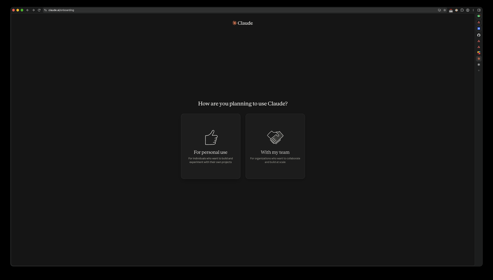

**You should see:** the claude.ai chat home page with your plan name in the account menu
(bottom left). Your organization is the personal one Claude creates for your Prism
account. It is named `you@prismteam.ai's Organization`, and it is the one you sign in to
in step 3.

**If you don't:**

- The card is declined: check the Ramp card limit with your manager, then retry.
- You see a team or enterprise organization instead of `you@prismteam.ai's Organization`:
  open the account menu, choose your personal organization, and continue.
- Do not buy a second plan if you already have Ultra or Max on this account. Both work.

---

## 2. Install Claude Code

**Where:** regular terminal

**Run:**

```bash
curl -fsSL https://claude.ai/install.sh | bash
```

The command shows nothing for up to a minute while it downloads. Wait.

**You should see:** `✔ Claude Code successfully installed!` with a version and the location
`~/.local/bin/claude`, and on the last line `✅ Installation complete!`.

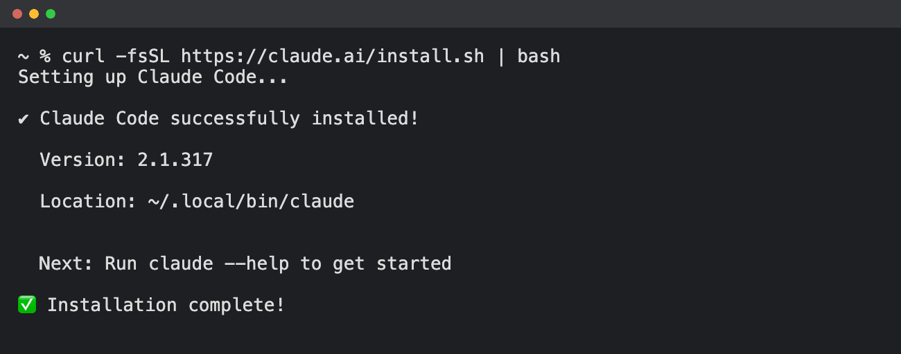

Then open a **new** terminal window (`⌘ N`) and run:

```bash
claude --version
```

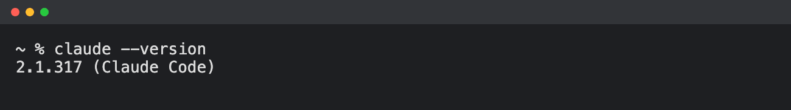

**If you don't:**

- The installer shows **Setup notes** saying `~/.local/bin is not in your PATH`, or
  `claude --version` says `command not found: claude`. Run the line it printed, then open a
  new terminal window:

  ```bash
  echo 'export PATH="$HOME/.local/bin:$PATH"' >> ~/.zshrc && source ~/.zshrc
  ```

  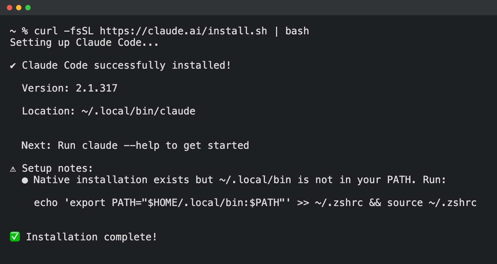

- `curl: (6) Could not resolve host` or a `403`: you are offline or behind a VPN that
  blocks `claude.ai`. Disconnect the VPN and retry.

---

## 3. Start Claude Code and sign in

### 3.1 First launch

**Where:** regular terminal, inside a project folder (any folder of yours works; for
example `mkdir -p ~/Projects && cd ~/Projects`)

**Run:**

```bash
claude
```

Claude Code opens full-screen in the terminal and asks a few one-time questions:

1. **Text style:** pick **Dark mode** (or whatever looks best) with the arrow keys and
   press `Return`.

   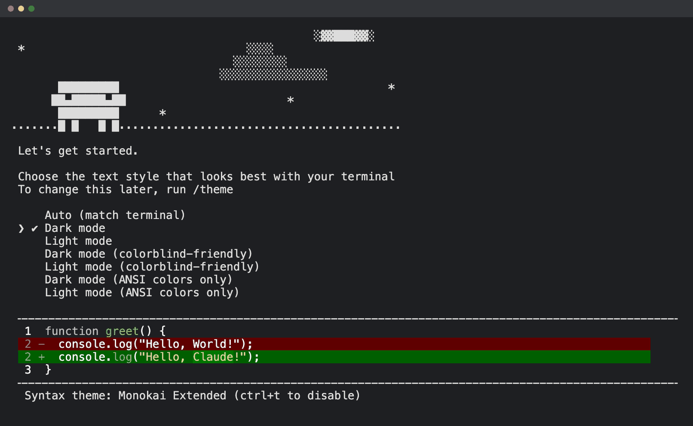

2. **Security notes:** press `Return`.

   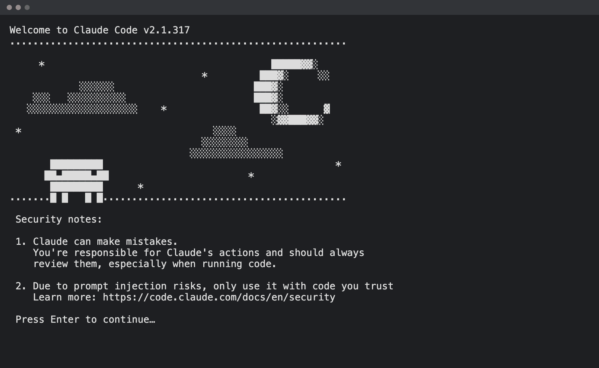

3. **Trust this folder:** press `↓` to select **Yes, I trust this folder**, then `Return`.
   The selection starts on **No, exit** in a new folder. Pressing `Return` straight away
   quits Claude Code.

   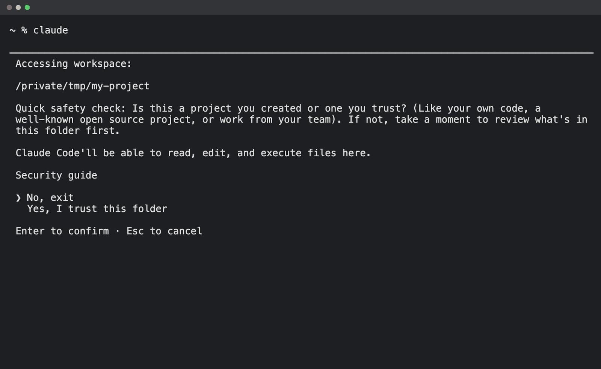

### 3.2 Sign in

**Where:** inside Claude Code (it asks on first launch; otherwise type `/login` and press
`Return`)

**Run:** choose **1. Claude account with subscription**.

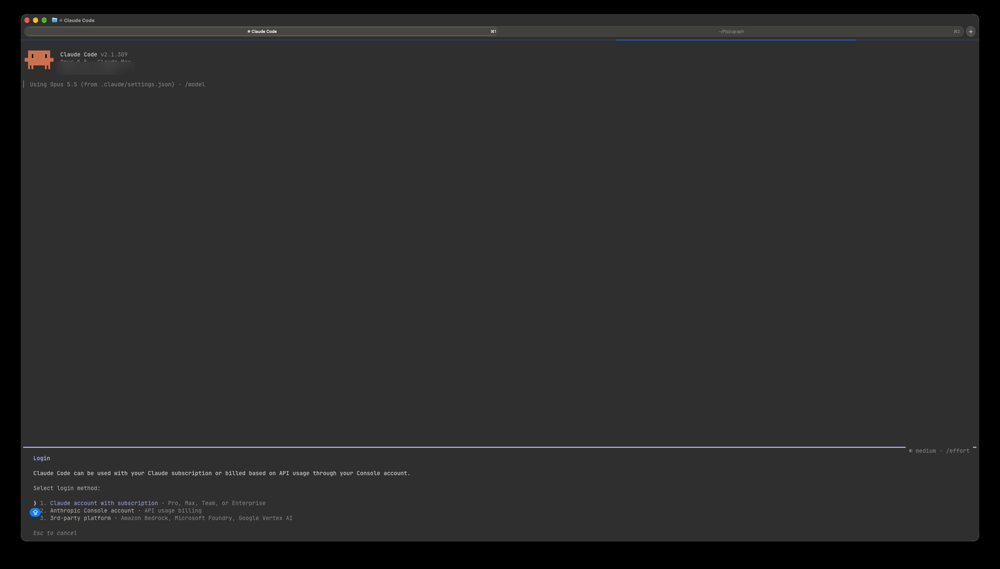

**Where:** browser. A window opens on its own; if it doesn't, press `c` in Claude Code to
copy the link and paste it into your browser.

**Run:** check that the page says *Logged in as* your `@prismteam.ai` address, then click
**Authorize**.

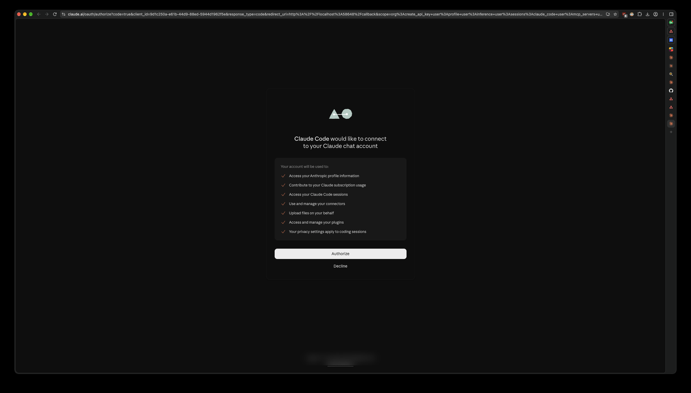

If the browser shows a code instead of returning to the terminal, copy it and paste it
into Claude Code at `Paste code here if prompted`.

**You should see:** `Login successful` in Claude Code, press `Return`.

### 3.3 Updated terms (if shown)

**Where:** inside Claude Code

If Claude Code shows **Updates to Consumer Terms and Policies**, choose
**2. Accept terms · Help improve our AI models: OFF** for company work, then press `Return`.
Until you answer this screen, every agent and test prompt fails with
`[ACTION REQUIRED] An update to our Consumer Terms…`.

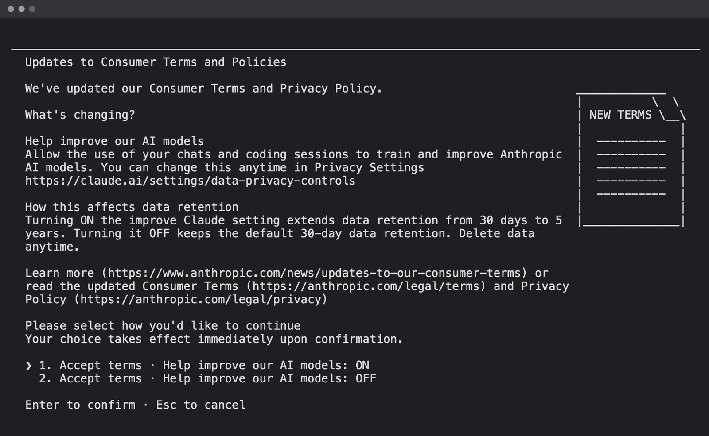

**You should see:** the Claude Code home screen with your model and plan in the header
(for example `Opus 5.5 · Claude Ultra`) and an empty `❯` prompt at the bottom.

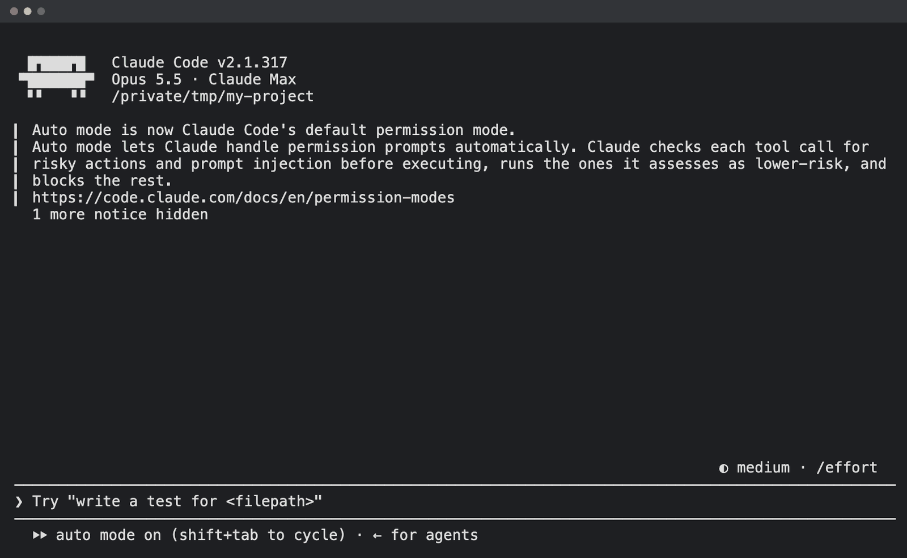

Type `/exit` and press `Return` to go back to the regular terminal.

**If you don't:**

- The header says `API Usage Billing` or the check in step 5 says you are not on a
  subscription: inside Claude Code run `/logout`, then `/login`, and pick option **1**.
- The browser shows a different Google account: click **Switch account** at the bottom of
  the Authorize page and pick your Prism account.
- To confirm from a regular terminal: `claude auth status --text` prints
  `Login method: Claude … account`, `Organization: you@prismteam.ai's Organization`, and
  your email.

---

## 4. Install the Soofi and SOC team kits

**Where:** regular terminal (not inside Claude Code)

### 4.1 Soofi team kit

**Run:**

```bash
claude plugin marketplace add soofi-xyz/soofi-xyz-team-kit
claude plugin install soofi-xyz-team-kit@soofi-xyz
```

**You should see:** `✔ Successfully added marketplace: soofi-xyz`, then
`✔ Successfully installed plugin: soofi-xyz-team-kit@soofi-xyz (scope: user)`.

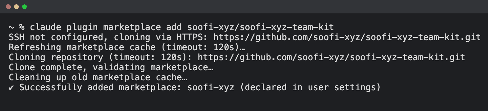

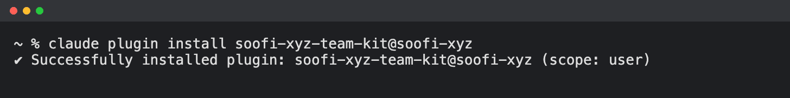

### 4.2 SOC team kit

The SOC team kit lives in an internal repository, so this step uses the GitHub sign-in
from step 0.2.

**Run:**

```bash
claude plugin marketplace add Spring-Oaks-Capital-LLC/soc-team-kit
claude plugin install soc-team-kit@socapital
```

**You should see:** `✔ Successfully added marketplace: socapital`, then
`✔ Successfully installed plugin: soc-team-kit@socapital (scope: user)`.

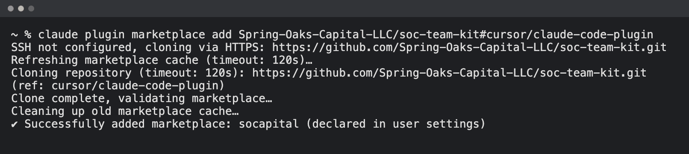

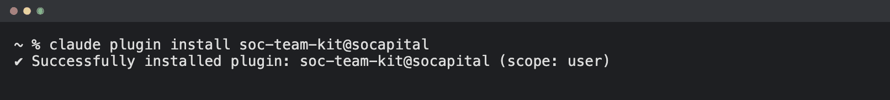

### 4.3 Confirm

**Run:**

```bash
claude plugin list
```

**You should see:** both kits with `Status: ✔ enabled`. The line
`Note: Default agents/ folder is ignored because the manifest sets "agents"` is expected;
ignore it.

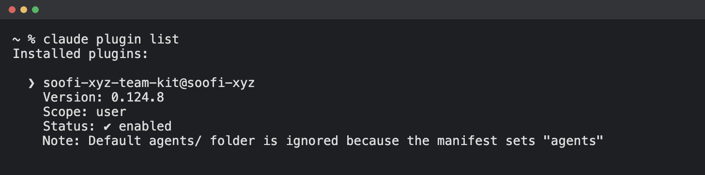

**If you don't:**

- `Failed to clone` or `Repository not found` for the SOC kit: your GitHub account has no
  access to `Spring-Oaks-Capital-LLC`, or git cannot use your sign-in. Run `gh auth status`
  and `gh auth setup-git`, accept the GitHub organization invitation, then retry.
- `Marketplace 'soofi-xyz' already exists`: it was added before. Run
  `claude plugin marketplace update soofi-xyz` and continue with the install line.
- `Plugin not found`: copy the install line exactly, including `@soofi-xyz` or `@socapital`.
- If Claude Code was open while you installed, type `/reload-plugins` inside it, or quit
  and start it again.

---

## 5. Check and test everything

### 5.1 One check command

**Where:** regular terminal

**Run:**

```bash
curl -fsSL https://raw.githubusercontent.com/soofi-xyz/soofi-xyz-team-kit/main/skills/team-kit-check/scripts/team-kit-check.sh | bash -s -- --test
```

It reports what is installed, which agents are available, which MCP servers are connected
or failing, and sends one test prompt per kit and per MCP server. Each failure comes with
its fix and where to run it. Drop `-s -- --test` for a quicker check without test prompts,
or use `--agents` to list every agent name. Inside Claude Code, the same check runs with
`/soofi-xyz-team-kit:team-kit-check`.

**You should see:** only `✔` lines and, at the end,
`✔ Everything required is installed and connected.`

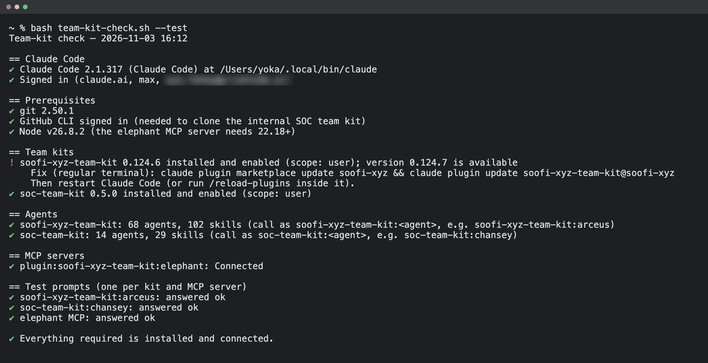

A `!` line is a warning, such as a newer kit version being available; apply its fix when
convenient. Every `✘` line has a fix under it.

**If you don't:** apply the fix printed under each `✘`, then run the check again. The most
common ones:

| You see | Fix | Where |
| --- | --- | --- |
| `Claude Code is installed at ~/.local/bin/claude but that folder is not on your PATH` | `echo 'export PATH="$HOME/.local/bin:$PATH"' >> ~/.zshrc && source ~/.zshrc` | regular terminal |
| `Not signed in` | `claude`, then `/login`, option **1** | inside Claude Code |
| `blocked by the updated Consumer Terms` | `claude`, answer the terms screen (option **2**), `/exit` | inside Claude Code |
| `marketplace '…' is not added` / `not installed` | the two lines from step 4 | regular terminal |
| `plugin:soofi-xyz-team-kit:elephant: ✘ Failed to connect` | `brew install node` (needs 22.18+), then `/mcp reconnect all` | regular terminal, then inside Claude Code |
| `! Needs authentication` | `/mcp`, select the server, **Authenticate** | inside Claude Code |

### 5.2 List agents and MCP servers yourself

**Where:** inside Claude Code (`claude`)

**Run:** type `/mcp` and press `Return`.

**You should see:** `plugin:soofi-xyz-team-kit:elephant` with a `✔` and its tool count.
Press `Esc` to close.

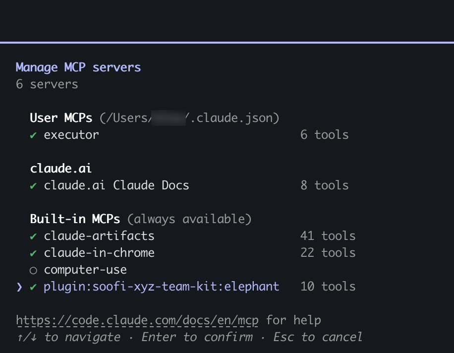

Agents appear as `soofi-xyz-team-kit:<agent>` and `soc-team-kit:<agent>`. The check's
`--agents` option lists all of them; the product agents are described in the
[README](../README.md#product-agents).

### 5.3 One test prompt per kit and MCP server

**Where:** inside Claude Code. Type each prompt and press `Return`.

**Soofi kit agent**

```text
Use the soofi-xyz-team-kit:arceus subagent to reply with exactly: ok
```

**You should see:** a `soofi-xyz-team-kit:arceus(…)` line, then `ok`.

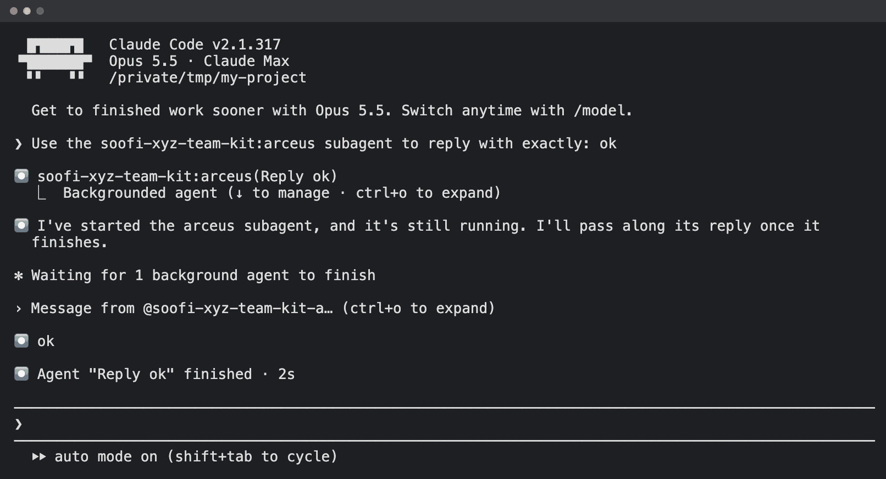

**SOC kit agent**

```text
Use the soc-team-kit:chansey subagent to reply with exactly: ok
```

**You should see:** `ok`. The screenshot shows the same prompt run from a regular
terminal with `claude -p "…"`, which prints only the answer.

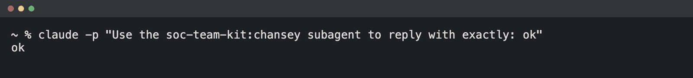

**Elephant MCP server**

```text
Use the elephant MCP server to list the published Atlas counties. Reply with how many there are and the first five names.
```

**You should see:** `Called plugin:soofi-xyz-team-kit:elephant`, then a count and county
names. The count grows as the server syncs the Atlas index.

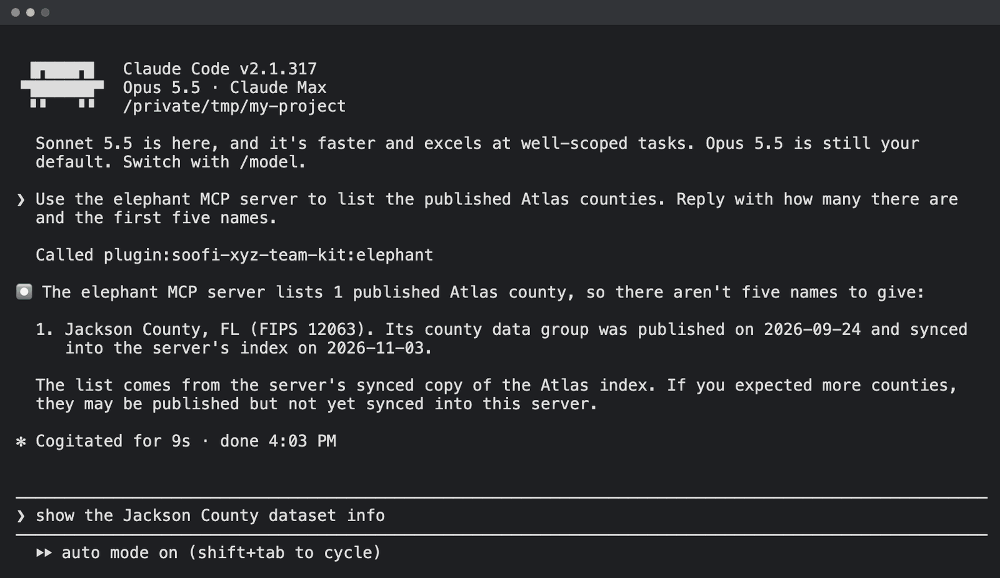

**If you don't:**

- `Agent type '…' not found`: the kit is not loaded in this session. Type
  `/reload-plugins`, or `/exit` and start `claude` again.
- Claude asks for permission to use a tool: choose **Yes**.
- `[ACTION REQUIRED] … Consumer Terms`: see [step 3.3](#33-updated-terms-if-shown).

---

## 6. Set up Amp for cloud runs (token)

Amp runs Claude Code threads in the cloud ("Orbs") on your Claude subscription, and lets
you share threads with the team. It is what replaces Cursor cloud agents (step 7).

### 6.1 Join the Prism workspace

**Where:** browser

**Run:** ask Mykyta Ovsiienko for the Amp workspace invite link (it is in the internal
Slab post *Claude code set up plan*), open it and sign in with your Prism Google account.

**You should see:** [ampcode.com](https://ampcode.com/) with the Prism workspace.

### 6.2 Connect your Claude subscription

**Where:** browser

**Run:**

1. In Amp, click your name at the bottom left and choose **Personal Settings**.

   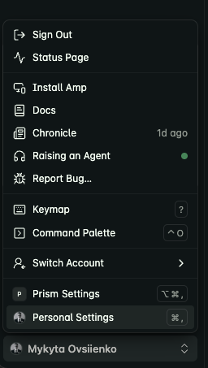

2. In the left sidebar, under **Agent**, choose **Model Routing**.

   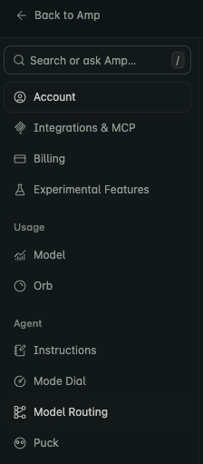

3. Under **Connect Your Claude Subscription** (top right), click
   **Connect Claude Subscription**.

   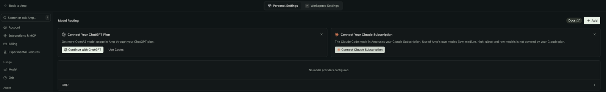

### 6.3 Create the token

**Where:** a **new regular terminal window** (`⌘ N`), not inside Claude Code

**Run:**

```bash
claude setup-token
```

It opens the same browser authorization as step 3.2. Click **Authorize**. The terminal then
prints a long token, valid for one year. It is not saved anywhere.

**Where:** browser (the Amp dialog)

**Run:** paste the token into **Token**, leave **Base URL** and everything else as it is,
and click **Verify & Connect**.

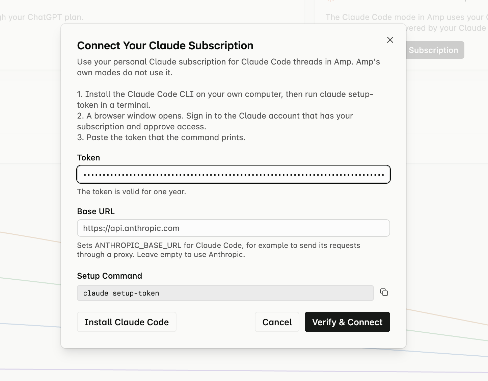

**You should see:** the Claude subscription shows as connected under Model Routing.

**If you don't:**

- `Verify & Connect` fails: run `claude setup-token` again and paste the new token. Copy
  the whole token on one line, with no spaces before or after it.
- Treat the token like a password. Never paste it into a chat, a ticket, a commit or a
  shared document. If it leaks, run `claude setup-token` again and replace it in Amp.

### 6.4 Start a thread

**Where:** browser (Amp)

**Run:**

1. Click the **New thread** button at the top left.

   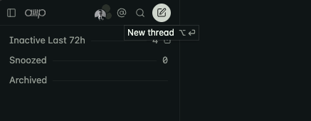

2. Pick a project. Projects cover the GitHub repositories in the Prism organization. Keep
   **Orb** selected: an Orb is a cloud machine and the preferred place to work. Use your
   own machine as the runner only in edge cases.

   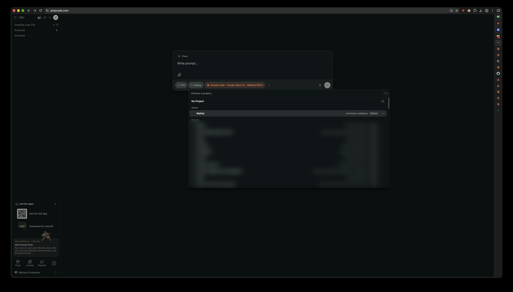

3. Change the mode to **Claude Code** so the thread uses your Claude subscription.

   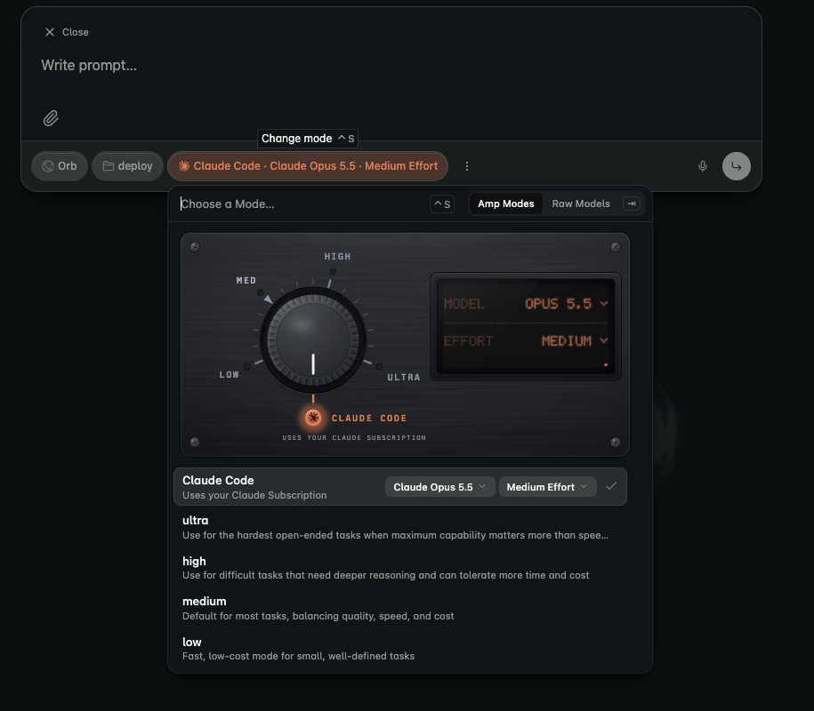

4. Write a prompt and start the conversation.

**You should see:** the thread running with `Claude Code` shown in the prompt bar.

**Share a thread:** click **Share** at the top right to get a link. To let others work in
the thread with you, click **Enable Multiplayer** next to it.


Open **Projects**, then a repository, to see everyone's threads on it.

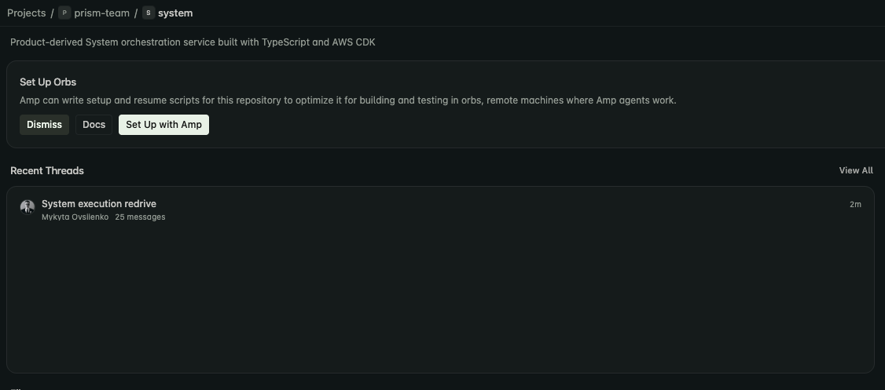

---

## 7. Move the agents you run today

Nothing is turned off until its replacement has run once. Work through this list and keep
the table below up to date while you do.

### 7.1 List what you run today

**Where:** browser and Cursor

1. **Cursor automations:** open [cursor.com/automations](https://cursor.com/automations)
   (or the Automations view in Cursor's Agents window). Write down each automation, its
   trigger (schedule, GitHub, Slack, Asana, webhook) and what it does.
2. **Cloud agents:** open [cursor.com/agents](https://cursor.com/agents). Write down each
   agent that is still running or that you start regularly.
3. **Scheduled loops:** in Cursor, look through open chats for `/loop` prompts, which repeat
   on an interval. They only run while that chat is open. Write down each prompt and
   interval.
4. **Deployed agent runtimes:** services that run in AWS, such as the Kirlia, Hypno, Rotom,
   Meowth or Pelipper runtimes. They do not depend on your editor.

### 7.2 Recreate or keep each one

| Running today | In Claude Code | Where to set it up |
| --- | --- | --- |
| Cursor automation on a schedule, GitHub event or API call | A **cloud scheduled task**. It runs in Anthropic's cloud, so your laptop can be closed. | Inside Claude Code: `/schedule`, or in the browser at [claude.ai/code/routines](https://claude.ai/code/routines) |
| Cursor automation triggered by Slack, Asana or another integration that scheduled tasks can't receive | **Keeps running in Cursor** for now. Record it in the table. | Nothing to do |
| `/loop` in a Cursor chat | `/loop <interval> <prompt>`, for example `/loop 30m check the deploy and tell me when it finishes`. It runs only while that session is open and expires after 7 days. For anything longer, use a cloud scheduled task. | Inside Claude Code |
| Cursor cloud agent | An **Amp thread in an Orb** with Claude Code mode ([step 6.4](#64-start-a-thread)) | Browser (Amp) |
| Deployed agent runtime (AWS) | **Keeps running where it is.** Confirm it in the table. | Nothing to do |

For each item:

1. Recreate it, using the same prompt and the same repository.
2. Wait for its first real run and check that the output matches the Cursor run.
3. Only then pause or delete the Cursor original, and note the date.

Keep this table in your pass-it-on notes:

| Name | Type | Today runs in | Replacement (or "keeps running") | Replacement's first run (date, link) | Original turned off (date) |
| --- | --- | --- | --- | --- | --- |
| *example: nightly dependency audit* | Cursor automation (schedule) | Cursor | Cloud scheduled task `dependency-audit` | 2026-11-04, link to run | 2026-11-05 |

**If you don't know** whether something can move, mark it "keeps running" and ask in your
pass-it-on pull request. Do not turn it off.

---

## Pass it on

This guide improves each time a new person follows it.

1. **Follow it from a clean machine without help.** Start from step 0 on a Mac without
   Claude Code. The order of testers is **Lucian Lazar** first, then the next new hire.
2. **Write down every place you got stuck or had to guess**, while it happens: the step,
   what you saw (copy the message or take a screenshot), and what you did to get past it.
   `/move-to-claude-code` keeps these notes for you in `~/move-to-claude-code-notes.md`.
3. **Fix the guide through a team-kit pull request** to
   [`soofi-xyz/soofi-xyz-team-kit`](https://github.com/soofi-xyz/soofi-xyz-team-kit). Edit
   this file and replace screenshots in `docs/images/move-to-claude-code/` with your own
   captures, keeping the file names. Blur personal emails, usernames and private
   repository names before committing. Add your row to the table below.
4. **Saman reviews each pull request.**
5. **Hand the updated guide to the next person** once the pull request is merged.

| Tester | Date | Machine | Where they got stuck | Pull request |
| --- | --- | --- | --- | --- |
| Lucian Lazar | | | | |

---

## Update or remove

**Where:** regular terminal

```bash
claude plugin marketplace update soofi-xyz && claude plugin update soofi-xyz-team-kit@soofi-xyz
claude plugin marketplace update socapital && claude plugin update soc-team-kit@socapital
```

Claude Code only picks up a new kit release when its version changes. After an update, type
`/reload-plugins` inside Claude Code, or start it again.

To remove a kit: `claude plugin uninstall soofi-xyz-team-kit@soofi-xyz` or
`claude plugin uninstall soc-team-kit@socapital`.

Claude Code's own docs: [setup](https://code.claude.com/docs/en/setup),
[authentication](https://code.claude.com/docs/en/authentication),
[plugins](https://code.claude.com/docs/en/discover-plugins),
[MCP](https://code.claude.com/docs/en/mcp),
[scheduled tasks](https://code.claude.com/docs/en/routines) and
[`/loop`](https://code.claude.com/docs/en/scheduled-tasks).
