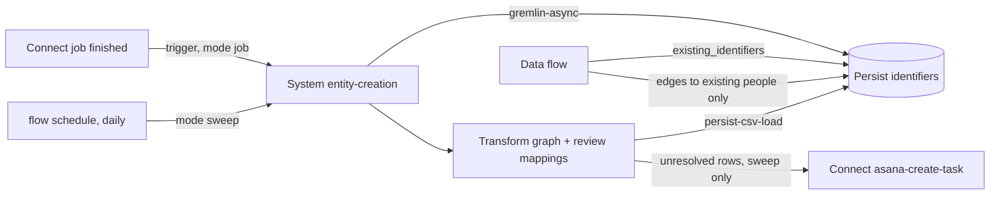

# Entity creation before data flows

People and companies are created by one entity-creation System flow per source,
before any data flow runs. Data flows (meetings, emails, utterances) only link to
people Persist already holds. Matching is deterministic: no model, no fuzzy or
name match. Reference implementation:
[entity-creation-system](https://github.com/prismteam-ai/entity-creation-system)
(Google Workspace directory and calendar),
[transform-entity-creation-configuration](https://github.com/prismteam-ai/transform-entity-creation-configuration)
and the edges-only Meet mappings in
[transform-google-meet-configuration](https://github.com/prismteam-ai/transform-google-meet-configuration)
(2.1.0 / Doc 1.7.0).

## Rules

1. **One entity-creation flow per source.** Its flow has a `trigger` on the
   source's Connect subscriber event (mode `job`, `idempotencyKey` the Connect
   job id) and a `schedule` for a daily sweep (mode `sweep`) that lists the
   source again. The template skips a failed job, a job with no or empty files
   and another Connect flow. Load directory people before calendar runs: a
   calendar run recognizes them only through Persist.
2. **Deterministic matching.** People match on a normalized email (trimmed,
   lowercased) or E.164 phone (10 digits or 11 starting with 1 become `+1…`;
   anything else, and any number with an extension, is dropped). Companies
   match on the domain of a URL or email (lowercased, leading `www.` removed;
   free-mail domains are never companies). Exactly one existing match is
   reused; two or more create nothing (`AMBIGUOUS_EXISTING`); an identifier two
   source people share links to neither. Role mailboxes, guest accounts and
   calendar resources are never people. New ids are stable:
   `<source>:users/<id>`, `entity-creation:person/email/<email>`,
   `entity-creation:company/domain/<domain>`. Keep the rules in one shared SQL
   file that the graph and review mappings both build from.
3. **Existing identifiers from Persist.** Read them with one shared-domain api
   step `POST /persist/gremlin-async` (unbound, base path `/persist`) returning
   `kind`, `value`, `vertex_id` for every `PERSON`, `EMAIL`, `PHONE` and
   `DOMAIN`, poll its status every 10 s, and bind the result object as the
   Transform input `existing_identifiers`. The mapping fails unless it is
   exactly one successful result document (an empty list is valid); otherwise
   every known person would look new.
4. **Data flows write edges only.** A data-flow mapping requires
   `existing_identifiers`, writes a people edge only when its person exists, and
   re-emits that `person` vertex exactly as Persist holds it (`~id`,
   `person_identifier`, `version`, no names) so Transform's endpoint check passes
   and the CSV load inserts nothing. It writes no `person` or `person_has_email`
   of its own; what it cannot link goes to a review mapping that is not loaded.
5. **Human review, nothing guessed.** Unresolved rows create nothing. They go to
   the review mapping's `unresolved_matches` (stable `unresolved_id`) in S3. Only
   the sweep opens a task: one Asana task a day through Connect
   `asana-create-task`, transaction id `entity-creation-review-<runKey>-r<redrive>`,
   naming the S3 prefix, never the rows (they hold names and addresses).
6. **Metrics on the flow.** Declare `metrics` in the flow (System with per-flow
   metrics, prismteam-ai/system#108): `values` from `$.counts.*`, dimension
   `source`. System publishes them to `System/FlowMetrics` (dimensions `flow`,
   `stack`, `source`) for succeeded runs only. A daily per-source Report over
   the review tables shows new people and companies, counted once per day and
   source (concurrent runs read the same Persist snapshot and list the same new
   entity), as in `meet-backfill-progress-report` `entity-creation-sources`.
7. **Retry Glue concurrency.** A burst of jobs hits Glue's concurrent-run limit.
   `Glue.ConcurrentRunsExceededException` reaches the run only as
   `States.TaskFailed` (the Glue name is in the cause), and a System `Retry`
   matches error names, so retry `States.TaskFailed` on each Transform step:
   `IntervalSeconds` 60, `MaxDelaySeconds` 120, `MaxAttempts` 6 (about 11
   minutes). System allows no `JitterStrategy`. Keep a mapping cost ceiling,
   since a broken mapping is retried too.

## Ownership

Zygarde owns the framework pieces this pattern relies on: triggers, schedules,
per-flow `metrics`, retrier limits and redrive. Celebi configures each source's
entity-creation flow and its tests; Silvally the matching and edges-only
mappings; Uxie the Persist query; Wingull the Connect activations and review
task; Bronzor the report.
